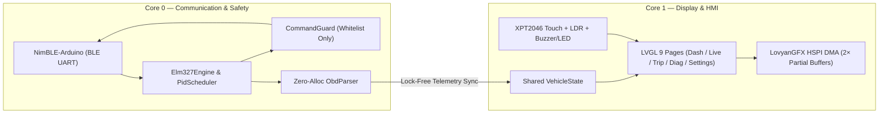

# DashStat

**High-Performance, ECU Read-Only OBD-II Digital Gauge & Telemetry Display for ESP32 CYD**

[](https://github.com/Trayrdy/DashStat/releases/tag/v1.0.0)
[](LICENSE)
[-orange?style=flat-square)](docs/kb/hardware.md)
[](platformio.ini)

DashStat turns an affordable **ESP32-2432S028R (Cheap Yellow Display / CYD)** into a responsive automotive digital dashboard and live OBD-II telemetry monitor over Bluetooth Low Energy (BLE) — built from the ground up with strict **ECU Read-Only safety** and zero-allocation memory discipline for PSRAM-less ESP32 boards.

---

## ✨ Key Features

- **100% ECU Read-Only Safety (`CommandGuard`):** Strict kernel-level whitelist only permits read-only OBD-II queries (`Mode 01`, `03`, `07`, `09`) and safe ELM327 `AT` commands. Destructive commands (`Mode 04/14` Clear DTC, actuator tests, UDS writes/resets) are permanently blocked and verified by unit tests.
- **Smooth UI without PSRAM:** Powered by **LVGL 9** and **LovyanGFX** (HSPI DMA with 2× partial buffers, ~20.48 KB SRAM) and backlight-blanked page transitions to eliminate screen tearing.
- **Low-Latency BLE OBD-II Engine:** Built on **NimBLE-Arduino** with `7.5ms` connection interval tuning, `ATAT2` adaptive timing, CAN response count hints, and non-blocking exponential backoff reconnect. Supports `0xFFF0`, `0xFFE0`, and Nordic UART (`vLinker MC+`, `OBDLink CX`, standard BLE ELM327 adapters).
- **Universal 24-PID Catalog:** 3 organized groups (Engine & Thermal, Air/Fuel/O2, Volt/Pedal/Diag) assignable to **4 Dashboard tiles** and **6 Live matrix slots**, including virtual **Turbo Boost (`MAP - BARO`)**.
- **100ms Live Waveform Chart:** Real-time oscilloscope-style telemetry plotting with live min/avg/max tracking.
- **Trip Computer & 0–100 km/h Drag Timer:** Tracks distance, drive time, top speed, and automatic 0–100 km/h sprint timing from standstill.
- **Read-Only DTC Diagnostics:** Scans Stored (`Mode 03`) and Pending (`Mode 07`) fault codes with built-in SAE J2012 lookup and Freeze Frame inspection.
- **Rich Customization:** **6 UI Color Themes**, **8 Speedometer Fonts**, **3 NavRail modes** (`Auto-Hide`, `Always-On`, `Tap-to-Call`), **180° Screen Rotation**, **4-Point Touch Calibration**, **Auto/Manual Brightness (LDR)**, **RPM Shift Alerts (RGB LED + DAC Audio Buzzer)**, and a built-in **Demo Mode** for bench testing.

---

## 🏗️ Dual-Core Architecture



---

## 🛠️ Hardware Requirements (BOM)

| Component | Specification | Notes |
|---|---|---|
| **Display Board** | **ESP32-2432S028R (CYD)** | 2.8" 320×240 ILI9341 TFT, XPT2046 Resistive Touch, RGB LED, LDR, GPIO 26 Speaker/DAC, 4MB Flash, No PSRAM |
| **OBD-II Adapter** | **BLE ELM327 / vLinker** | Bluetooth Low Energy 4.0+ (`0xFFF0`, `0xFFE0`, or Nordic UART GATT service) — e.g. `vLinker MC+`, `OBDLink CX` |
| **Power Supply** | **5V / 1A USB** | USB car charger or 12V-to-5V DC buck converter |

---

## 🚀 Quick Start (Build & Flash)

### Prerequisites
- [PlatformIO Core (CLI)](https://platformio.org/install/cli) or VS Code with the PlatformIO IDE extension

### Build & Upload to ESP32 CYD
```bash
# Clone the repository
git clone https://github.com/Trayrdy/DashStat.git
cd DashStat

# Build firmware
pio run -e esp32-cyd

# Flash firmware via USB
pio run -e esp32-cyd -t upload

# (Optional) Monitor serial logs
pio device monitor -b 115200
```

### Run Unit Tests (`native`)
```bash
# Requires gcc/g++ on host PATH
pio test -e native
```

---

## 📖 Documentation

- **[User Manual (คู่มือการใช้งานภาษาไทย)](docs/USER_MANUAL.md)** — Full setup guide, screen walkthroughs, settings, and Universal 24-PID reference
- **[ECU Read-Only Safety Specification](docs/kb/ecu_safety.md)** — 3-tier CommandGuard whitelist & blacklist policy
- **[Hardware Pinout & CYD Specs](docs/kb/hardware.md)** — Complete GPIO mapping and BLE adapter details
- **[LVGL 9 & DMA Memory Notes](docs/kb/lvgl_notes.md)** — Partial DMA buffering without PSRAM
- **[OBD-II PIDs & Low-Latency Tuning](docs/kb/obd2_pids.md)** — Multi-PID requests and zero-allocation parsing

---

## 🇹🇭 ภาพรวมภาษาไทย (Thai Summary)

**DashStat** คือโปรเจกต์เกจวัดดิจิทัลและจอแสดงผลข้อมูลรถยนต์แบบเรียลไทม์ผ่านพอร์ต OBD-II (Bluetooth Low Energy) สำหรับบอร์ด **ESP32 CYD (2.8" 320×240 Touchscreen)** ออกแบบให้ทำงานลื่นไหล บนบอร์ดที่ไม่มี PSRAM พร้อมความปลอดภัยสูงสุด:

* **ปลอดภัยต่อกล่อง ECU 100% (Read-Only):** ระบบ `CommandGuard` อนุญาตเฉพาะคำสั่งอ่านค่า (`Mode 01/03/07/09`) เท่านั้น บล็อกคำสั่งลบโค้ด (`Mode 04`) หรือเขียนทับค่า ECU ถาวร
* **อ่านค่าไว หน่วงต่ำ:** รองรับ Multi-PID, Response Count Hint, การเชื่อมต่อ BLE `7.5ms` และกราฟคลื่นสดทุกๆ 100ms
* **ครบเครื่องการใช้งานจริง:** เลือกดูค่าเซนเซอร์ได้อิสระจาก **24 Universal PIDs** (รวม Boost จำลอง `MAP - BARO`), โหมดจับเวลา **0–100 km/h Drag Test**, ทริปคอมพิวเตอร์, สแกนโค้ดไฟรูปเครื่อง (DTC + Freeze Frame), เปลี่ยนธีมได้ 6 สี, ฟอนต์ความเร็ว 8 แบบ และมี Demo Mode ทดสอบบนโต๊ะโดยไม่ต้องต่อรถ
* อ่านคู่มือการใช้งานฉบับเต็มได้ที่ **[docs/USER_MANUAL.md](docs/USER_MANUAL.md)**

---

## ⚠️ Disclaimer

DashStat is intended for **informational and monitoring purposes only**. Although `CommandGuard` enforces a strict read-only policy, you use this software at your own risk. Always obey local traffic laws and **never interact with the touchscreen while driving** (DashStat automatically locks touch controls while the vehicle is in motion).

---

## 🤝 Contributors & Credits

- **[Trayrdy](https://github.com/Trayrdy)** — Plan & Prompt
- **Gemini (Antigravity)** — Architecture, Low-Latency Optimization & AI Co-Developer
- **CarCYD (by muki01)** — UI Design Inspiration (GPL-3.0)
- **Open-Source Libraries & Assets:**
  - [LVGL 9](https://lvgl.io/) (MIT)
  - [LovyanGFX](https://github.com/lovyan03/LovyanGFX) (FreeBSD)
  - [NimBLE-Arduino](https://github.com/h2zero/NimBLE-Arduino) (Apache-2.0)
  - [Material Design Icons](https://pictogrammers.com/library/mdi/) (Apache-2.0)
  - [Barlow Condensed / Semi Condensed](https://fonts.google.com/specimen/Barlow) (SIL OFL 1.1)

---

## 📄 License

This project is licensed under the **GNU General Public License v3.0 (GPL-3.0)** — see the [LICENSE](LICENSE) file for details.
